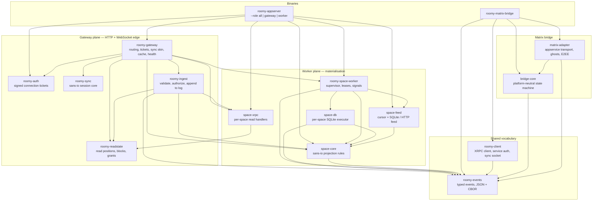

# Roomy Rust crates

The Rust side of Roomy. `roomy-appserver` and `roomy-matrix-bridge` are the
binaries; everything else is a library they compose. The appserver binary runs
one role per process (`--role all|gateway|worker`): the gateway plane and the
worker plane are the same crates whether they share a process or are split
across machines, and they meet only at the change feed, the global database, and
the post-commit signal sink.

Arrows are runtime dependency edges from each crate's `Cargo.toml`; dev-only
edges are omitted.

## Gateway plane

The edge. It resolves a request to the space that owns the data, authorizes the
caller, and either reads the materialised rows or appends a write to the log. It
never materialises.

| Crate             | Role                                                                                                                              |
| ----------------- | --------------------------------------------------------------------------------------------------------------------------------- |
| `roomy-gateway`   | Axum composition: routing to a space, tickets, the WebSocket skin over `roomy-sync`, the response cache, health and metrics.      |
| `roomy-auth`      | Connection tickets as signed JWTs — self-contained, short-lived, audience-bound, one-shot via a nonce store.                      |
| `roomy-sync`      | Sans-io connection plane: subscriptions, frame ordering, reconnect cursors. No socket.                                            |
| `roomy-readstate` | Caller-scoped state behind one trait: read positions, block sets, membership, bridge grants.                                      |
| `roomy-ingest`    | The write ingress: per-event authorization, then one transactional append of the entry, its record changes, and the stream index. |

## Worker plane

Materialisation. A supervisor runs one actor per space; each pulls changes from
a cursor, plans them without I/O, and applies the result to the space's SQLite
file. Reads over that file are a separate crate.

| Crate                | Role                                                                                            |
| -------------------- | ----------------------------------------------------------------------------------------------- |
| `roomy-space-worker` | The supervisor and its seams: leases, global and signal sinks, clock, per-space cancellation.   |
| `space-feed`         | The change feed contract over a cursor, with SQLite and HTTP-pull implementations.              |
| `space-core`         | Projection rules: change record in, SQL effects and derived steps out, no database.             |
| `space-db`           | Executes those effects into a per-space SQLite file and reproduces the rebuild-equality digest. |
| `space-xrpc`         | Per-space read handlers and access decisions over an open space database.                       |

## Shared

| Crate          | Role                                                                                                |
| -------------- | --------------------------------------------------------------------------------------------------- |
| `roomy-events` | Typed construction and encoding of Roomy events: JSON for `sendEvents`, CBOR/DRISL for sync frames. |
| `roomy-client` | The outbound counterpart: XRPC calls, PDS service-auth tokens, the sync socket.                     |

## Matrix bridge

Independent of the appserver crates; it talks to them only over XRPC.

| Crate                 | Role                                                                                                |
| --------------------- | --------------------------------------------------------------------------------------------------- |
| `roomy-matrix-bridge` | The binary: appservice, admin API, supervisor, bridge-local SQLite.                                 |
| `matrix-adapter`      | Matrix-shaped transport: appservice registration, ghosts, media, end-to-bridge encryption.          |
| `bridge-core`         | Platform-neutral bridge state machine: echo suppression, edit/redaction ordering, cursors, retries. |
